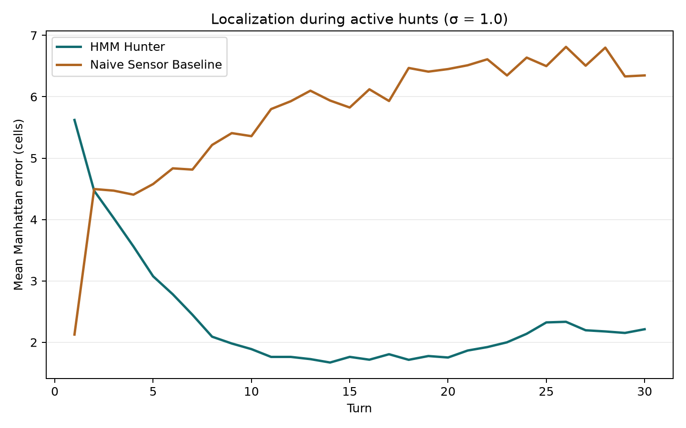
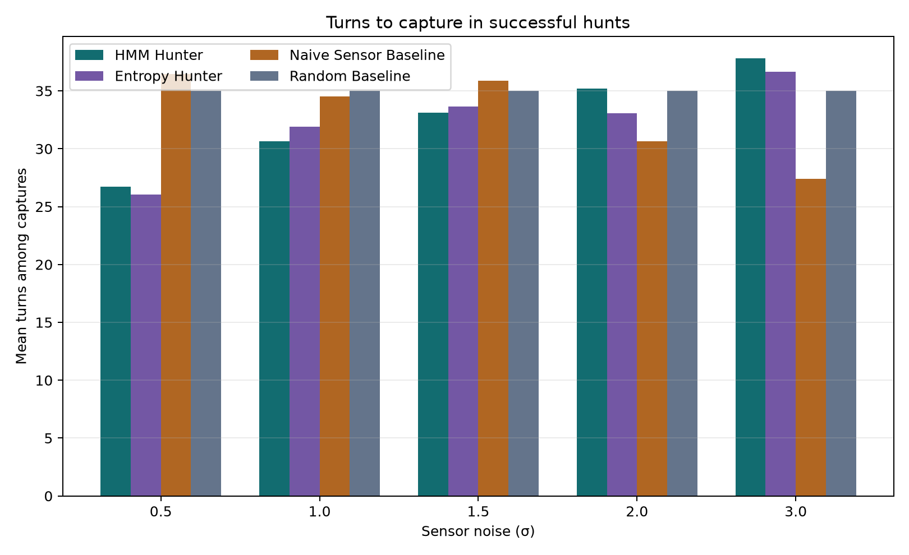
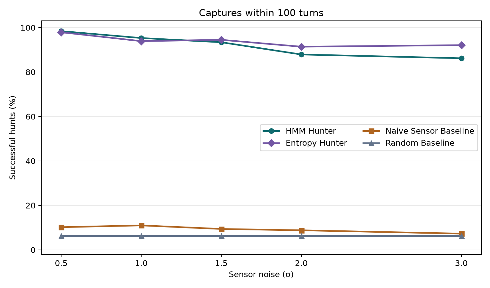

# Ghost Hunter — project report

**Tracking an Invisible Enemy with Hidden Markov Models**

AL-2002 Artificial Intelligence Laboratory, Fall 2026

FAST – National University of Computer and Emerging Sciences, Karachi Campus

| Team member | Roll number | Section | Contribution |
| --- | --- | --- | --- |
| M. Hassnain | 24k-3020 | BSE-5A | Probabilistic modeling, sensor model and benchmark analysis |
| Syed Khalid Ali Abidi | 24k-3005 | BSE-5A | Game engine, Pygame interface and agent behaviors |

## 1. Task and environment

A hunter must locate one invisible ghost in a connected maze. In the proposal's standard setting, the board has 10 × 10 cells and the turn limit is 100. The hunter moves one cell north, south, east or west, or waits. Walls block movement and give collision feedback. The hunter captures the ghost by entering its cell. If it escapes that check, the ghost moves to a legal neighboring cell or stays. A ghost that moves onto the hunter is also captured. The final allowed turn can produce a win.

The sensor returns the Manhattan distance after adding Gaussian noise, rounding to the nearest integer and clipping at zero. This gives distance without direction. Several cells can explain any one reading. Performance is measured by capture rate, turns among successful captures and localization error in cells.

## 2. Tracking and pathfinding

The hidden state is the ghost's cell. The prior is uniform over free cells, and walls have zero probability. For a hunter at $h_t$, the Forward algorithm predicts the distribution and then corrects it using the new reading $e_t$.

$$
b'_t(j)=\sum_i P(j\mid i,h_t)b_{t-1}(i), \qquad
b_t(j)=\frac{P(e_t\mid j,h_t)b'_t(j)}{\sum_k P(e_t\mid k,h_t)b'_t(k)}.
$$

The transition model uses the same movement weights as the simulated ghost. A move that increases its distance from the hunter has weight 2, staying at the same distance has weight 1, and moving closer has weight 0.5. We normalize over legal destinations. The sensor likelihood integrates Gaussian probability over each integer's rounding interval. A reading of zero includes the entire clipped lower tail. The implementation applies a small probability floor to free cells before normalization.

The **HMM Hunter** plans a shortest path with A* to the most probable cell. Directional momentum breaks equal-priority ties. The **Entropy Hunter** also uses the posterior. When its highest cell probability is below 0.18, it evaluates the expected information in the next ping at each legal neighboring position, with a penalty for moving away from likely cells. It switches to MAP pursuit when the posterior concentrates.

The **Naive Sensor** baseline uses only the latest reading. It samples one free cell on the nearest matching distance ring and takes a legal greedy step toward it. The **Random Walk** baseline samples uniformly from valid moves, including waiting.

## 3. Fixed-seed experiments

Each policy ran 100 trials on each of 10 mazes at five noise levels, $\sigma\in\{0.5,1.0,1.5,2.0,3.0\}$. This produced **5,000 hunts per policy and 20,000 in total**. The layouts ranged from zero to 29 walls. Policies shared the same maze and starting seed for each comparison. Every episode used the turn-based environment and a 100-turn limit.

| Policy | Captures / 5,000 | Capture rate | Mean turns among captures | Mean localization error (cells) |
| --- | ---: | ---: | ---: | ---: |
| HMM Hunter | 4,612 | 92.24% | 32.51 | 2.56 |
| Entropy Hunter | 4,698 | 93.96% | 32.20 | 2.42 |
| Naive Sensor | 467 | 9.34% | 33.37 | 6.41 |
| Random Walk | 315 | 6.30% | 35.02 | — |

Capture rates include all trials. Turns to capture include successful trials only. Localization error is the mean of the episode-level mean Manhattan errors. The random walker produces no location estimate.

At the highest noise level, the HMM Hunter captured the ghost in 86.2% of hunts, the Entropy Hunter in 92.1%, and the Naive Sensor baseline in 7.3%. The proposal projected a threefold improvement in capture time. Among successful hunts, the observed difference between the HMM Hunter and the Naive Sensor baseline was 0.86 turns. The larger gain was finishing before the limit.

## 4. Competitive difficulty

In AI vs Human, both hunters get their first movement opportunity together and share a 0.16-second minimum between steps. Each hunter can enter one adjacent free cell per opportunity. On reaching the ghost, that hunter's clock and move count stop. The other hunter can continue until capture or the shared turn limit. At the end, the scorecard compares both sets of moves, active times and points.

A capture earns 1,000 points minus 10 per active second and one per successful move, with time rounded to the nearest tenth and a minimum capture score of one. An unfinished hunt scores zero. The higher score wins and equal scores draw.

A noisy range gives the rival a set of plausible ghost cells. On Beginner it samples a target from the latest reading. On Intermediate it uses the most probable cell from the HMM and updates its target after at most two moves. Hard compares the chances of a capture along several shortest routes and replans at every step. Extreme also forecasts the ghost's movement, compares both hunters' maze distances to possible interception cells, and considers which first step will give a more informative reading.

A* finds a shortest path through the walls to the chosen cell. The planner sends one movement action back to the game. The map and reticle show the human hunter's belief, and X draws the human hunter's radar route. During the existing public ghost glimpse, both trackers learn its exact cell. Between glimpses the rival uses noisy readings and the outcome of its moves to track the hidden ghost.

We ran 200 races per level for each of two scripted players on seeds 1000-1199 at a simulated 30 frames per second. One player activated radar whenever it recharged and followed its public belief map between uses. The second followed that map throughout. Both used A* for their own movement. The game and the evaluation use the same movement scheduler, turn limits and score calculation.

| Difficulty | AI wins vs. radar player | AI win rate | AI wins vs. heatmap player | AI win rate |
| --- | ---: | ---: | ---: | ---: |
| Beginner | 20/200 | 10% | 30/200 | 15% |
| Intermediate | 54/200 | 27% | 112/200 | 56% |
| Hard | 93/200 | 46.5% | 120/200 | 60% |
| Extreme | 121/200 | 60.5% | 137/200 | 68.5% |

All 1,600 races are included. A tied score contributes to the total number of races and earns neither side an outright win. The timeout column counts races in which both hunters finished with zero points.

The CSVs record wins, ties, timeouts and movement timing for the live race evaluations. [Radar races](../results/raw/race_difficulty.csv) · [Heatmap races](../results/raw/race_heatmap.csv) · [Turn-based benchmark data](../results/raw/benchmark_summary.csv)
